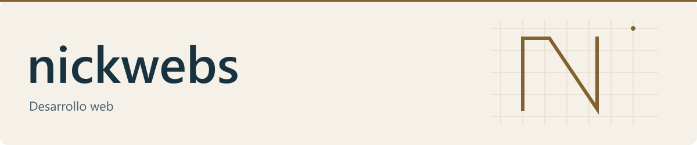

<picture>
  <source media="(prefers-color-scheme: dark) and (max-width: 600px)" srcset="assets/hero/hero-dark-mobile.svg">
  <source media="(prefers-color-scheme: light) and (max-width: 600px)" srcset="assets/hero/hero-light-mobile.svg">
  <source media="(prefers-color-scheme: dark)" srcset="assets/hero/hero-dark.svg">
  <source media="(prefers-color-scheme: light)" srcset="assets/hero/hero-light.svg">
  
</picture>

# Izan

Desarrollo web con claridad y cuidado.

&nbsp;HTML &nbsp;
&nbsp;CSS &nbsp;
&nbsp;JavaScript 
&nbsp;PHP &nbsp;
&nbsp;Symfony

[iryx.es](https://iryx.es/)
